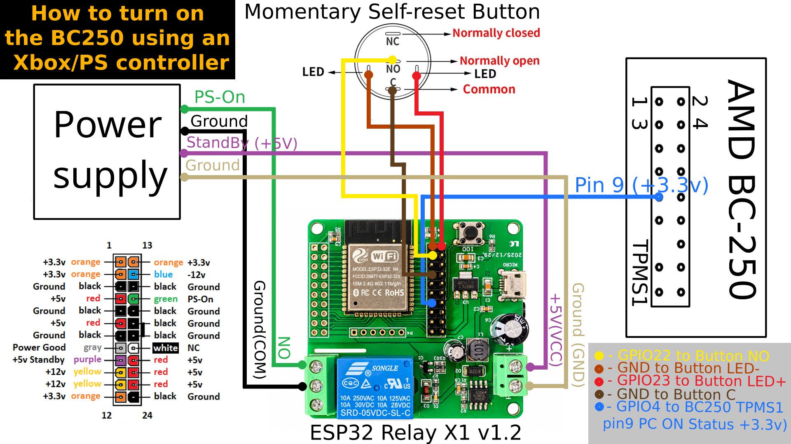

# BC250 ESP32 Controller Power ON — v1.8.0

**AI-assisted firmware for powering on an AMD BC-250 using Xbox and Sony DualSense controllers with an ESP32 Relay X1 v1.2.**

[](https://www.youtube.com/watch?v=xPFkxIStFa0)

▶ **[Watch the full video tutorial on YouTube](https://www.youtube.com/watch?v=xPFkxIStFa0)**

> **Hardware-tested by the maintainer:** Xbox and DualSense controllers successfully woke the BC-250 with this build. Compatibility with every controller model or revision is not guaranteed. But it is possible.

## Contents

- [Features](#features)
- [Hardware required](#hardware-required)
- [Wiring diagram](#wiring-diagram)
- [Button functions](#button-functions)
- [Flash the firmware on SteamOS](#flash-the-firmware-on-steamos)
- [Connect the ESP32 to the BC-250](#connect-the-esp32-to-the-bc-250)
- [Configure controllers](#configure-controllers)
- [Troubleshooting](#troubleshooting)
- [Safety](#safety)
- [Support the Project](#support-the-project)
- [Original project and acknowledgements](#original-project-and-acknowledgements)
- [License status](#license-status)

## Features

- Wake the BC-250 using supported Xbox and Sony DualSense controllers.
- Keep a list of authorized controller Bluetooth MAC addresses (up to five entries in this build).
- Control the ATX PSU `PS_ON` signal through relay 1 on the ESP32 Relay X1 v1.2.
- Use a physical momentary button for power-on, shutdown, ESP32 restart and mode switching.
- Configure controller addresses and settings through a Wi-Fi access point and web interface.
- Switch between Bluetooth operation and Wi-Fi configuration mode. Bluetooth and the Wi-Fi AP are used in exclusive modes to reduce stability problems.

## Hardware required

- ESP32 Relay X1 v1.2 using a compatible original ESP32 (not ESP32-C3).
- AMD BC-250 board and its ATX power supply.
- Momentary self-reset button with LED (optional LED wiring as shown below).
- FT232RL USB-to-UART adapter and a USB data cable for flashing.
- Dupont jumper wires and suitable wiring for the PSU connections.
- Xbox controller and/or Sony DualSense controller.
- A computer running Arduino IDE 2. This guide uses SteamOS; other operating systems may require different serial-port permissions and steps.

## Wiring diagram

The diagram below is for the **ESP32 Relay X1 v1.2** build. Do not assume that X2 wiring is identical.



### Connection reference

| Source | Destination | Purpose |
|---|---|---|
| PSU green `PS_ON` wire | Relay 1 `NO` | PSU power control |
| PSU ground | Relay 1 `COM` | Relay contact return |
| PSU +5 V standby | ESP32 board `+5V/VCC` input | Standby power for the ESP32 |
| PSU ground | ESP32 board `GND` input | Power ground |
| Momentary button `NO` | GPIO22 | Physical power button input |
| Button `C` / common | ESP32 `GND` | Button common |
| Button LED `+` | GPIO23 | Button LED control (check the button's electrical requirements) |
| Button LED `−` | ESP32 `GND` | LED return |
| BC-250 TPMS1 pin 9 | GPIO4 | BC-250 on/off status signal, nominally 3.3 V |

GPIO17 is retained as a legacy definition in the source, but relay 2 is not used by the X1 hardware build. The optional status LED is defined on GPIO2.

**Important:** confirm the pin numbering and polarity against your own board and the diagram before connecting anything. Never apply 5 V or 12 V directly to an ESP32 GPIO.

## Button functions

The firmware evaluates the button action when you **release** it. The exact behavior depends on whether the BC-250 is on or off.

| BC-250 state | Button hold | Action |
|---|---:|---|
| Off, Bluetooth mode | Short press, under 5 seconds | Start the BC-250 |
| Off | About 5–9 seconds | Restart the ESP32 without starting the BC-250 |
| Off | 10 seconds or longer | Switch between Bluetooth mode and Wi-Fi AP configuration mode, then restart |
| On | Short press | Request normal shutdown (availability depends on the configured hardware/build) |
| On | 5 seconds or longer | Force shutdown; unsaved data may be lost |

For a reliable timing test, aim for approximately 1 second, 7 seconds and 12 seconds. In Wi-Fi configuration mode, a short press while the BC-250 is off does not start it.

## Flash the firmware on SteamOS

### 1. Prepare SteamOS

Switch to Desktop Mode and open a terminal with `Ctrl` + `Alt` + `T`.

Check your username:

```bash
whoami
```

If your user account does not yet have a password, set one with:

```bash
passwd
```

### 2. Install Arduino IDE 2

Install **Arduino IDE 2** from the Discover software center. Open it once, then create a new sketch if necessary.

### 3. Add the ESP32 and Bluepad32 board package URLs

In Arduino IDE, open **File → Preferences** and add these two URLs under **Additional boards manager URLs**, one per line:

```text
https://raw.githubusercontent.com/espressif/arduino-esp32/gh-pages/package_esp32_index.json
https://raw.githubusercontent.com/ricardoquesada/esp32-arduino-lib-builder/master/bluepad32_files/package_esp32_bluepad32_index.json
```

Open **Tools → Board → Boards Manager** and install:

- `esp32` by Espressif Systems
- `ESP32_bluepad32` by Ricardo Quesada

Then open **Tools → Manage Libraries** and install:

- `ArduinoJson` by Benoit Blanchon

The sketch also uses Bluepad32, BTstack and ESP32 framework components. The archive does not include a dependency lockfile, so compatible package versions may be needed if upstream packages change.

### 4. Install the LittleFS upload tool

Download the `arduino-littlefs-upload-1.6.3.vsix` release asset from:

[arduino-littlefs-upload releases](https://github.com/earlephilhower/arduino-littlefs-upload/releases)

Copy the `.vsix` file into:

```text
~/.arduinoIDE/plugins/
```

Create the `plugins` directory if it does not exist. Restart Arduino IDE. Press `Ctrl` + `Shift` + `P` and search for `LittleFS`; the command **Upload LittleFS to pico/ESP8266/ESP32** should appear.

### 5. Connect the FT232RL adapter

Connect the FT232RL to the computer using a USB **data** cable. Check which serial port was assigned:

```bash
lsusb
sudo dmesg | grep -i tty
ls -l /dev/ttyUSB*
```

On the SteamOS setup used for the video, the adapter appeared as `/dev/ttyUSB0` and belonged to the `uucp` group. Your port or group may differ. If your system uses `uucp` and your user is not in that group, you can add the user with:

```bash
sudo usermod -aG uucp "$USER"
```

Log out and back in (or reboot) for the group change to take effect. Do not assume `uucp` is the correct group on every Linux distribution.

Connect the adapter's UART pins to the ESP32 programming header according to the board pinout and the video. Set the adapter voltage jumper as shown in the tutorial, and double-check the pin labels before applying power.

### 6. Open and configure the sketch

Extract this repository and open:

```text
firmware/ota_pc_remote/ota_pc_remote.ino
```

In Arduino IDE, select **Tools → Board → ESP32_bluepad32 → ESP32 Dev Module**, then select the correct serial port. Enable **Erase All Flash Before Sketch Upload** for a clean installation. Leave other settings as required by the compatible board package and partition layout.

Before uploading, edit `firmware/ota_pc_remote/security_config.h`:

- Change `AP_SSID` if you want a different Wi-Fi access-point name.
- Replace `AP_PASSWORD` with a unique password of 8–63 ASCII characters.
- Replace `WEB_USERNAME` and `WEB_PASSWORD` with your own credentials.

Do not publish real passwords in commits or screenshots. These values are compiled into the firmware; changing them later requires rebuilding and flashing.

### 7. Upload the sketch

To enter download mode, disconnect the adapter from USB, hold the ESP32 `BOOT` / `IO0` button, reconnect USB, wait about two seconds, then release `BOOT`. In Arduino IDE, click **Verify** first if you want to compile without flashing, then click **Upload**.

If you see `Failed to connect to ESP32: No serial data received`, repeat the BOOT procedure and check the serial port, UART wiring and adapter voltage selection.

### 8. Upload the web interface to LittleFS

Uploading the sketch does **not** upload the web-interface files. Close Serial Monitor so the serial port is released. Enter ESP32 download mode again, press `Ctrl` + `Shift` + `P`, select **Upload LittleFS to pico/ESP8266/ESP32**, and wait for the completion message.

Close the LittleFS upload output, reconnect the board and open Serial Monitor at **115200 baud** to inspect startup logs.

## Connect the ESP32 to the BC-250

Use the wiring diagram above and verify all connections before reconnecting mains power:

1. Connect PSU `PS_ON` (green) to relay 1 `NO`.
2. Connect PSU ground to relay 1 `COM`.
3. Connect PSU +5 V standby to the board's `+5V/VCC` input and the corresponding ground to `GND`.
4. Connect the momentary button and its LED to GPIO22, GPIO23 and GND as shown.
5. Connect BC-250 TPMS1 pin 9 to GPIO4. This is a **3.3 V status signal**.
6. Insulate exposed conductors and ensure the ESP32 board cannot short against the BC-250 backplate.

The project uses the TPMS1 pin 9 signal to determine whether the BC-250 is running. If that signal is not present or the wiring is incorrect, the firmware may report that the PC did not power on even if the relay operated.

## Configure controllers

### 1. Record the controller addresses

Boot the BC-250 and pair the controller(s) with the BC-250 / SteamOS in the normal Bluetooth settings. Record each controller's Bluetooth MAC address. For DualSense, also record the BC-250 Bluetooth adapter address. On SteamOS, the following command lists Bluetooth adapters:

```bash
bluetoothctl list
```

### 2. Open the ESP32 configuration page

With the BC-250 off, hold the physical button for 10 seconds or longer and release it to switch to Wi-Fi AP configuration mode. Connect a phone or computer to the SSID configured in `security_config.h`, then open:

```text
http://192.168.4.1/
```

Log in with the web-interface credentials you configured before flashing.

### 3. Set up DualSense and Xbox

- In **Setup**, enter the BC-250 Bluetooth adapter MAC address in **Bluetooth spoof address** and save it. This spoof address is intended for PlayStation controllers such as DualSense; Xbox setup does not require this step.
- In **Add controller MAC manually**, enter a controller's Bluetooth MAC address and choose **Add MAC Without pairing**.
- Repeat for each controller you want to authorize. This build supports up to five stored controller entries.
- When finished, use the physical button to leave Wi-Fi AP mode and return to Bluetooth mode (hold for 10 seconds or longer while the BC-250 is off).
- Test waking the BC-250 with the Xbox controller's Xbox button or the DualSense PS button.

The maintainer tested Xbox and DualSense controllers. Other controllers may work through [Bluepad32](https://github.com/ricardoquesada/bluepad32), but they have not all been tested with this particular build.

## Troubleshooting

- **ESP32 does not connect for flashing:** enter download mode with BOOT/IO0 held during USB reconnection; check the selected port and UART wiring.
- **Serial Monitor shows garbled text:** select `115200` baud.
- **Web interface does not load:** confirm LittleFS upload completed, the ESP32 is in Wi-Fi AP mode, and the correct SSID/password are being used.
- **Controller does not wake the BC-250:** confirm its MAC address is in the authorized list, return to Bluetooth mode, and verify the DualSense spoof address if using a PlayStation controller.
- **Firmware reports that the PC did not power on:** check the TPMS1 pin 9 connection to GPIO4 and verify the 3.3 V signal while the BC-250 is running.
- **ESP32 keeps rebooting or appears unresponsive:** verify the power supply and wiring, then check startup logs at 115200 baud. The firmware alternates Bluetooth and Wi-Fi AP operation rather than keeping both active at once.

## Safety

This project involves an ATX power supply and hardware connected to mains-powered equipment. Disconnect the PSU from mains before wiring or changing connections. Use appropriate insulation and strain relief. Verify board input voltage, relay isolation and signal levels with a multimeter. Never connect 5 V or 12 V directly to an ESP32 GPIO. Forced shutdown can cause data loss. Follow this guide at your own risk; if you are not confident working with electronics, do not attempt the hardware modifications.

## Support the Project

If you find this project useful or enjoy my work, please consider subscribing to my YouTube channel, giving the video a like, leaving a comment, and sharing it with your communities, groups, and forums. Every share helps more people discover the project and supports the growth of the channel.

If you'd like to support my work financially, I'd really appreciate it! All links can be found in the video description.

Thank you for your support! ❤️

## Original project and acknowledgements

This project adapts work from [PetteriLah/BC-250-PC-Remote-Control](https://github.com/PetteriLah/BC-250-PC-Remote-Control), particularly the BC-250 power-control implementation, DualSense support and web interface. It also relates to the wider BC-250 controller project ecosystem, including [dexikdex/ESP32-BC250-LOP_PSU-PowerON-Xbox](https://github.com/dexikdex/ESP32-BC250-LOP_PSU-PowerON-Xbox), [GreatApo/BC250_ESP32_ATX_PSU](https://github.com/GreatApo/BC250_ESP32_ATX_PSU), and [Bluepad32](https://github.com/ricardoquesada/bluepad32).

The maintainer defined the requirements, integrated the hardware and tested the firmware on a real BC-250 system. **ChatGPT by OpenAI** assisted with firmware development, debugging, integration and documentation. This is an AI-assisted community project and is not affiliated with or endorsed by the upstream authors or OpenAI.

## License status

No blanket license is included in this repository at this time. The exact licensing and provenance of all upstream-derived code must be reviewed before others redistribute or modify the project. Attribution does not replace permission or compliance with applicable upstream licenses. See [`NOTICE.md`](NOTICE.md) for additional provenance notes.

## Repository layout

- `firmware/ota_pc_remote/` — Arduino sketch, headers and web-interface files.
- `docs/images/wiring-diagram.png` — wiring diagram for the ESP32 Relay X1 v1.2 build.
- `docs/` — development, testing and configuration notes.
- `RELEASE_NOTES.md` — release notes for v1.8.0.
